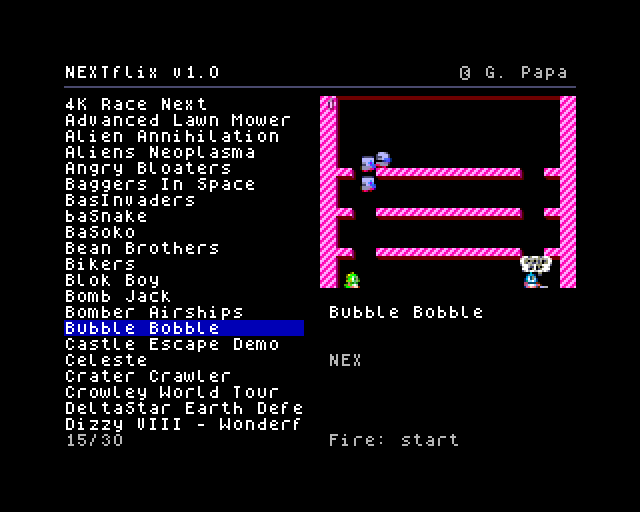
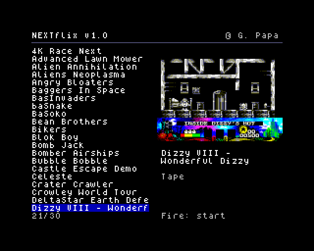
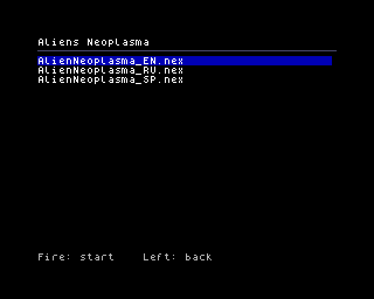
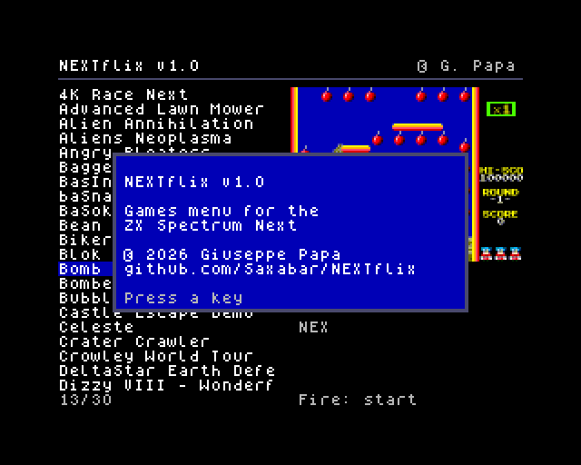
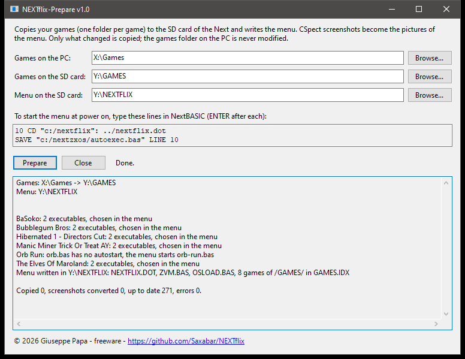

# NEXTflix

[](https://github.com/Saxabar/NEXTflix/releases/latest)
[](https://buymeacoffee.com/saxabar)

A games menu for the ZX Spectrum Next: the list of your games on the left, a picture of the
selected one on the right, joystick or keys to choose, fire to play. Games start as they do from
the NextZXOS Browser: `.nex`, `.snx`, `.sna`, `.tap`, BASIC programs and Z-machine adventures.

It has two parts:

- **NEXTflix-Prepare** (Windows): copies your games folder to the SD card of the Next, makes the
  pictures and writes the menu.
- **NEXTflix** (Next): the menu, a NextZXOS dot command (`NEXTFLIX.DOT`).

Requirements: a ZX Spectrum Next with NextZXOS (tested with 2.08 and 2.09); Windows with the
.NET Framework 4 (already there on Windows 10 and 11).

Download: `NEXTflix-1.0.zip` from the [Releases](https://github.com/Saxabar/NEXTflix/releases) page.

 

 

## 1. Prepare the SD card

Put the games in a folder on the PC, one folder per game, for example:

```
Games\
   Bomb Jack\          BombJack.nex, BombJack_2026_10_23___16_44_59.png
   Orb Run\            orb.bas, ...
   The Elves Of Maroland\
      PART1\           MAR1.tap, ...
      PART2\           MAR2.tap, ...
```

The name of the folder is the name shown in the menu. Pictures come from the F5 screenshots of
the CSpect emulator (`<name>_<date>.png`), the latest one of the game.

Put the SD card in the PC (say it is drive `E:`), start `NEXTflix-Prepare.exe` and choose three
folders:

- **Games on the PC**: the folder with your games, e.g. `C:\Games`.
- **Games on the SD card**: where they go, e.g. `E:\GAMES`.
- **Menu on the SD card**: where the menu goes, on the same drive, e.g. `E:\NEXTFLIX` (suggested
  when you choose the games folder).

Then press **Prepare**. The window remembers the folders for the next time.



- Run it again after adding or changing games: only what changed is copied. The games folder on
  the PC is never modified.
- The menu folder gets `NEXTFLIX.DOT`, the list of the games `GAMES.IDX` and two small loaders,
  `OSLOAD.BAS` and `ZVM.BAS`.
- Screenshots become pictures for the Next (`.bmp` 256x192 and `.nlp` 128x96, next to them).
- A game with more executables (e.g. a compilation) shows a list to choose from. BASIC programs
  saved without autostart get a copy that starts by itself (`<name>-run.bas`).

## 2. Start the menu

From the **Browser** of NextZXOS: open the menu folder (e.g. `NEXTFLIX`) and choose `NEXTFLIX.DOT`.

To start it **at power on**, choose NextBASIC from the main menu of NextZXOS and type these two
lines (ENTER after each). NEXTflix-Prepare shows them with your menu folder; for `E:\NEXTFLIX`:

```
10 CD "c:/nextflix": ../nextflix.dot
SAVE "c:/nextzxos/autoexec.bas" LINE 10
```

If you already have a `c:/nextzxos/autoexec.bas`, save it first with another name, e.g. from the
NextZXOS command line: `.mv c:/nextzxos/autoexec.bas c:/nextzxos/autoexec.old`. To stop the menu
starting at power on, delete or rename `c:/nextzxos/autoexec.bas` (e.g. from the Browser).

## 3. Use it

| | Keyboard | Joystick |
|---|---|---|
| Previous / next game | cursor up / down | up / down |
| Previous / next letter | cursor left / right | left / right |
| First game with a letter | the letter | |
| Start the game | ENTER, SPACE | fire (Mega Drive pad: A or B) |
| Information | EDIT (CAPS SHIFT + 1) | Mega Drive pad: START |
| Back to NextZXOS | BREAK (CAPS SHIFT + SPACE) | Mega Drive pad: C |

Joysticks work in the mode set on the Next: Kempston, Mega Drive, Sinclair or Cursor.

Starting the games:

- `.nex` with `.nexload`, `.snx` with `SPECTRUM`, BASIC with `LOAD`.
- `.tap` and `.sna`: with the Tape Loader and the Snapshot Loader of NextZXOS. The first time they
  ask how to start (128K, 48K, ... or ENTER), then they remember it and the game starts at once.
  To change it, press SYM SHIFT + ENTER on the file in the Browser.
- Z-machine adventures (`.z3` .. `.z8`): with ZXZVM, which must be in
  `C:/games/Z-Machine/zxzvm` as on the standard SD card of the Next.

To come back to the menu after a game, reset the Next (with the autoexec it starts again).

## Support

NEXTflix is free, and it will stay free. If it brings your games back to life and you want to
say thanks, you can buy me a coffee: it keeps me going on NEXTflix and on the next projects.

[](https://buymeacoffee.com/saxabar)

Bug reports and ideas are welcome too, in the [Issues](https://github.com/Saxabar/NEXTflix/issues).

## Licence

Freeware: free to use and to distribute unmodified, without asking money for it; see [LICENSE](LICENSE) (LICENSE.txt in the package).
Built with [z88dk](https://github.com/z88dk/z88dk). ZX Spectrum Next is a trademark of SpecNext Ltd;
NEXTflix is not affiliated with it.
